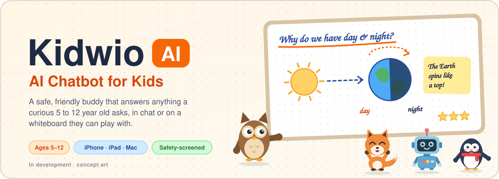
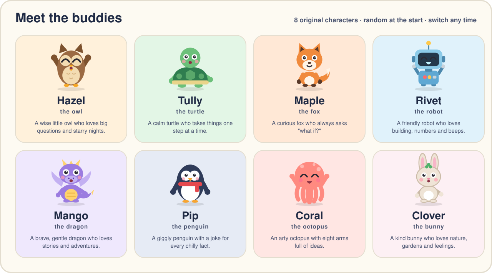
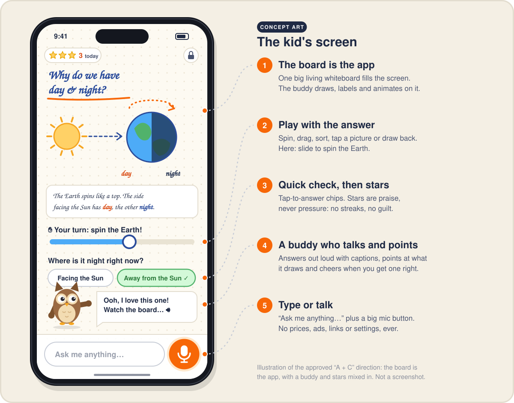
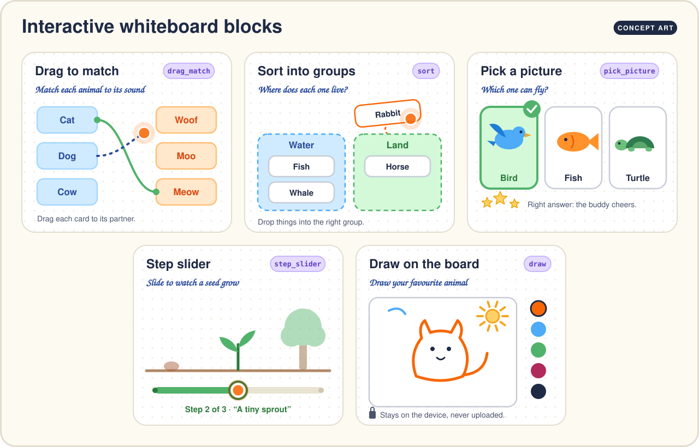
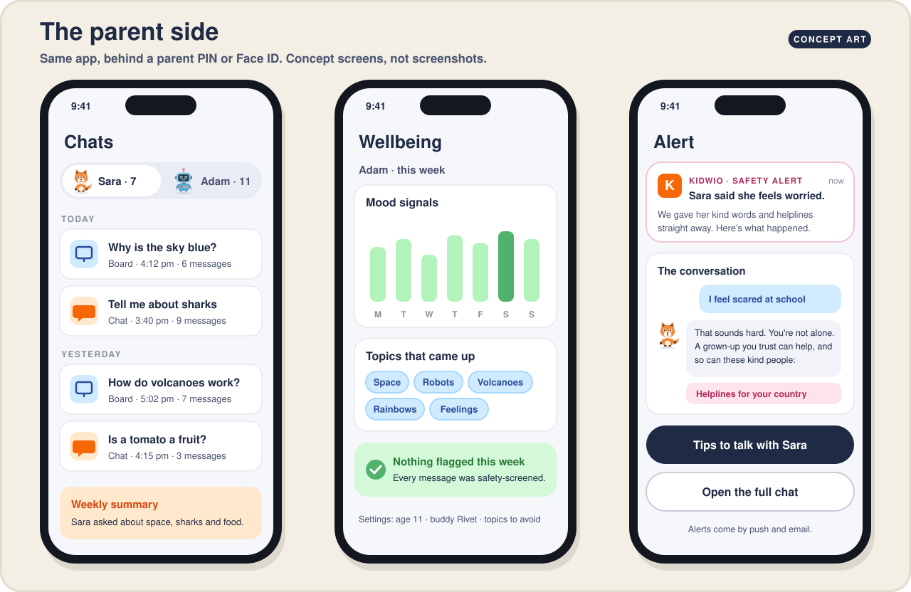

  

# Kidwio AI beta

Thanks for helping us test **Kidwio AI**, a friendly AI chatbot and interactive whiteboard for curious kids aged **5–12**.

Kids ask anything they wonder about, like why the sky is blue, how volcanoes work or what owls eat. A buddy answers on a whiteboard, in words that suit the child's age. Grown-ups set things up and can see every chat. Every message is checked for safety.

> **This is a beta.** Expect rough edges. Please don't use real sensitive information while testing.

---

## ⬇️ Download

| Device | How to get it |
|---|---|
| 💻 **Mac** (macOS 12 or newer, Apple silicon or Intel) | **[Download the latest Mac build →](../../releases/latest)** |
| 📱 **iPhone and iPad** | For now, open the **web version** in Safari (link in the latest release notes), then tap **Share → Add to Home Screen**. The App Store / TestFlight version comes later. |

**The first build is coming soon.** Watch this repo (top right, **Watch → Custom → Releases**) to get an email when a new build is ready.

### Installing on a Mac
1. Download the `.dmg` file from the latest release.
2. Open it and drag **Kidwio AI** into **Applications**.
3. The beta isn't signed by Apple yet, so the first time you open it, **right-click the app → Open → Open**. After that it opens normally.
   - If macOS still blocks it, go to **System Settings → Privacy & Security** and click **Open Anyway** next to Kidwio AI.

---

## 🦉 Meet the buddies

Each child gets a random buddy to start with and can switch any time.

## 🧒 What kids see

- **The board is the app.** Ask a question and the buddy explains it on the whiteboard.
- **Hands-on boards.** Drag-and-match, sort, pick-a-picture, sliders and drawing make answers something kids can play with.

- **Made for their age.** A 6-year-old and an 11-year-old get different explanations.
- **Safe by design.** Every message is checked. For worrying topics, the buddy kindly suggests talking to a grown-up.

## 👨‍👩‍👧 What grown-ups get

- The parent area sits behind a **parent login and PIN**, in the same app.
- **Create a profile for each child** and set their age.
- See **chat history** and a simple **wellbeing** view.
- Choose **topics to avoid** for each child.

---

## 🧪 What to test

Please try these and tell us what felt confusing, slow or wrong:

1. **Set up:** create a parent account, add a child, and set the age and a PIN.
2. **Kid side:** ask 5–10 real questions a child might ask. Try the interactive boards. Switch buddies.
3. **Age:** try the same question with a younger and an older child profile.
4. **Parent side:** check that chat history and wellbeing show what happened.
5. **Topics to avoid:** add one, then ask about it on the kid side.
6. **Free allowance:** see what happens when the free chats or boards run out.

### Beta limits (known, on purpose)
- **Purchases are simulated.** There's a "Simulate purchase (test)" button; no real money is involved.
- **Sign in with Apple, Face ID and notifications are off** in this beta. Use email and password.
- **iPhone and iPad** use the web version until the App Store / TestFlight build is ready.

## 💬 Send feedback

- **Open an issue** in this repo (**Issues → New issue**). Say which device you used, what you did, and what happened. Screenshots help a lot.
- Or reply to the person who invited you to the beta.

Please **don't post a child's real name or chat content** in a public issue.

---

Kidwio AI · <a href="https://kidwio.com">kidwio.com</a> · This repo holds the beta downloads and tester notes only.
